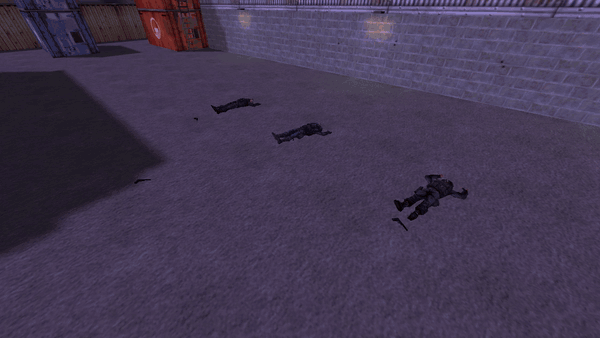

<h1 align="center">Corpse Gore</h1>

<p align="center">
  
</p>

## 📝 Description
This plugin replaces the default Counter-Strike 1.6 corpses with gibbable corpses.
Corpses can be shot, knifed or blown up, and burst into gibs, blood and floor decals, with runtime control over every effect.
- Replaces the default player corpse with a custom gibbable corpse
- Corpses can be gibbed with the knife
- Corpses can be gibbed with grenades and explosions
- Bullets hitting a corpse spawn a blood spray at the hit point
- Configurable gib velocity, count and life
- Configurable blood color and scale
- Blood decal placed on the floor under the corpse
- Corpses are only made solid once no player is standing inside them
- Corpses are removed automatically on every round start

## 📋 Requirements
- ReGameDLL
- AMX Mod X 1.10+

## ⚙️ Configuration
```ini
# Plugin settings (defined as cvars):
# corpsegore_enable                = 0 - Disabled         1 - Enabled
# corpsegore_gib_knife             = 0 - Disabled         1 - Enabled (Gib the corpse with the knife)
# corpsegore_gib_explosive         = 0 - Disabled         1 - Enabled (Gib the corpse with grenades and explosions)
# corpsegore_gib_bullet            = 0 - Disabled         Damage required to gib a corpse with bullets
# corpsegore_break_velocity        = Random velocity of the gibs (0 - 255)
# corpsegore_break_count           = Number of gibs (0 - 255)
# corpsegore_break_life            = Life of the gibs in 0.1 second units (0 - 255)
# corpsegore_blood_color           = Color of the blood         195 - Yellow            247 - Red
# corpsegore_blood_scale           = Scale of the blood sprite (0 - 255)
# Velocity, count, life and blood scale are randomized slightly around the cvar value on every gib.
```

## 🔄 Changelog
```text
* v1.0: Initial release.
```

[](https://www.youtube.com/watch?v=Q4awRNOEF1g)
